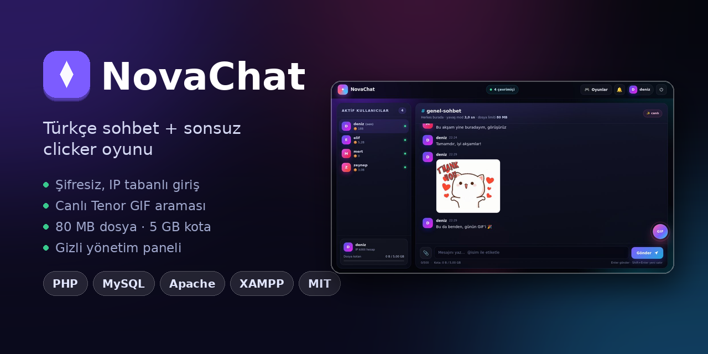
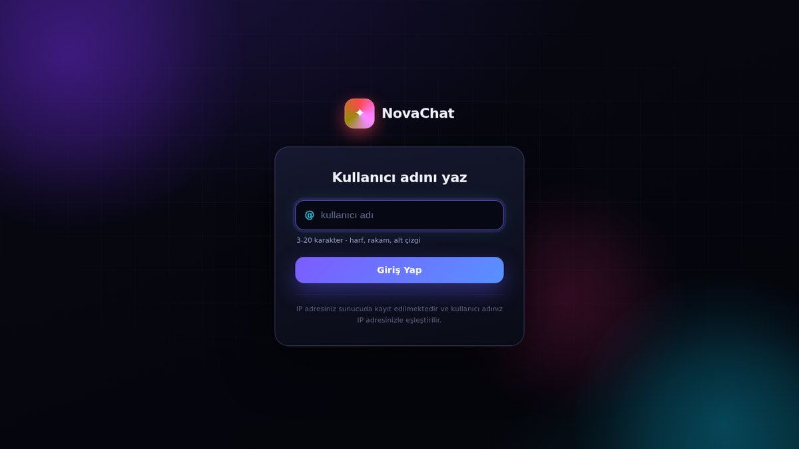
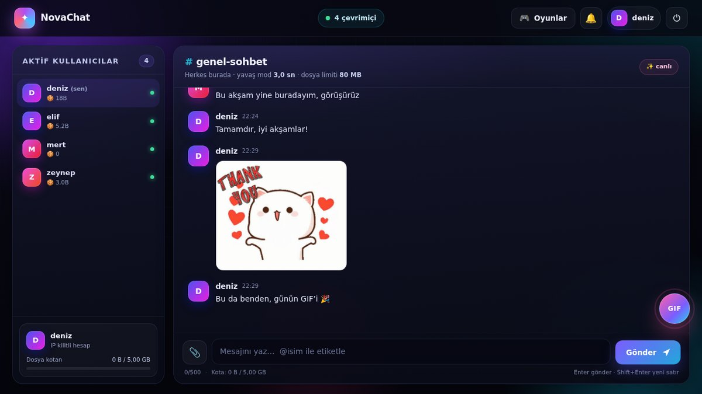
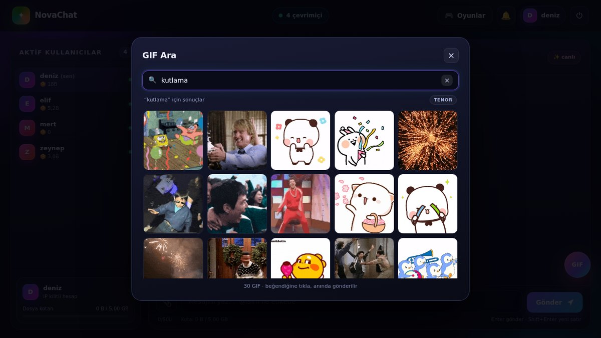
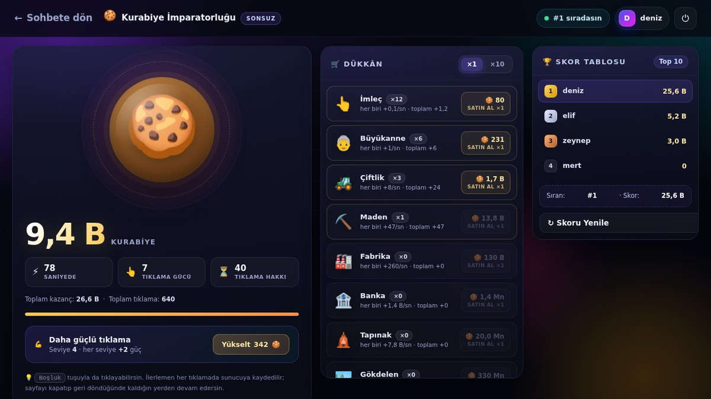
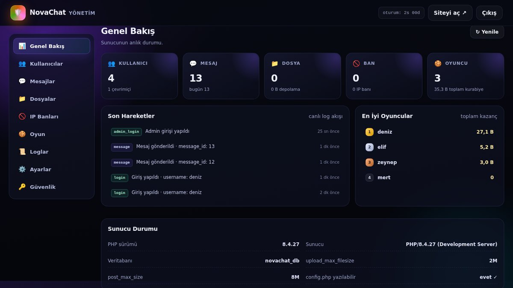

# 🚀 NovaChat

`PHP 8+` · `MySQL` · `Apache` · `MIT Lisans` · Kurulum: **2 adım**

**XAMPP üzerinde çalışan, tek komutla kurulan Türkçe sohbet sitesi.** Şifresiz (IP tabanlı) giriş,
tek genel sohbet odası, dosya & GIF paylaşımı, sonsuz clicker oyunu ve gizli yönetim paneli.

Tüm veriler **sunucu tarafında** tutulur — veritabanı, tablolar ve klasörler ilk açılışta
**kendiliğinden** oluşur. phpMyAdmin'de elle hiçbir şey yapmazsın.



---

## 📸 Ekran görüntüleri

| Giriş | Sohbet |
|---|---|
|  |  |

| GIF arama (Tenor) | Clicker oyunu |
|---|---|
|  |  |

| Yönetim paneli |
|---|
|  |

---

## ✨ Özellikler

### 🔑 Giriş (şifresiz)
- Sadece **kullanıcı adı** ile giriş — şifre yok.
- Şifre yerine **IP adresi** otomatik kaydedilir, hesap o IP'ye kilitlenir.
- İlk girişte hesap açılır; **aynı IP**'den tekrar girildiğinde otomatik giriş yapar.
- **Farklı IP**'den o ad alınamaz → kimse başkasının kullanıcı adını ele geçiremez.
- Kalıcı oturum çerezi (`HttpOnly`, `SameSite=Lax`) sayesinde tarayıcı kapansa da oturum sürer.

### 💬 Sohbet
- Tek **#genel-sohbet** odası (DM yok). Açılışta son **100 mesaj** yüklenir, sonrası canlı akar
  (3 saniyelik yoklama). Tarih ayırıcıları, otomatik bağlantı algılama, “yeni mesajlar” çubuğu ve skeleton yükleme.
- Solda **aktif kullanıcılar** listesi (son 70 saniye) + kurabiye skorları + “yazıyor” göstergesi.
- **Yavaş mod:** varsayılan 3 sn, panelden 0–60 sn arası ayarlanabilir (geri sayım çubuğu ile).
- **Yanıtlama:** mesaja alıntı yap → orijinal mesaja atlar ve vurgular.
- **Etiketleme:** `@kullanıcı` → mesajda vurgu, bildirim ve sekme başlığında sayaç.
- **Masaüstü bildirimi:** 🔔 butonu ile izin ver, sekme arkadayken yeni mesaj bildirimi al.
- Tüm mesaj geçmişi ve loglar veritabanında tutulur; silinen mesajlar yönetici tarafından geri getirilebilir.

### 📎 Dosya paylaşımı
- Tek dosya **en fazla 80 MB** (panelden 1–80 MB arası ayarlanabilir).
- İzinli türler: resim (`jpg/png/gif/webp`), video (`mp4/webm/mov`), ses (`mp3/ogg/wav/m4a`),
  `pdf`, ofis (`doc/docx/xls/xlsx/ppt/pptx`), `txt`, `zip/rar/7z`.
- **IP başına toplam kota:** varsayılan **5 GB** (panelden değiştirilebilir).
- Dosya içeriği `finfo` ile doğrulanır; uzantı–içerik uyuşmazlığı ve PHP/HTML/SVG içerik reddedilir.
- Dosyalar **uzantısız** (rastgele `.dat`) saklanır ve yalnızca `api.php?action=file` üzerinden,
  oturum kontrolüyle sunulur. `uploads/.htaccess` doğrudan erişimi tamamen kapatır.

### 🎁 GIF gönderimi (canlı Tenor)
- Sağ alttaki küçük **GIF** butonu → arama çubuğu + anlık sonuç ızgarası.
- Boş arama = **popüler GIF'ler**. GIF'e tıkla → anında gönderilir.
- Projede **hiç GIF dosyası barındırılmaz**; tümü Tenor CDN'inden canlı gelir.
- Sonuçlar sunucuda **15 dakika** önbelleklenir (`nc_cache`), tekrar eden istekler anında yanıtlanır.
- Yalnızca `https://*.tenor.com` adresleri kabul edilir; başka alan adı, `..`, boşluk veya
  `javascript:` gibi şemalar reddedilir.
- Arama, kullanıcı başına **40 istek / 60 sn** ile sınırlıdır; panelden tamamen kapatılabilir.
- Tenor'a ulaşılamazsa son önbellek gösterilir; o da yoksa “tekrar dene” ekranı çıkar.

### 🍪 Oyun: Kurabiye İmparatorluğu (`game.php`)
- **Sonsuz** clicker: 10 bina, 10x toplu alım, tıklama gücü yükseltmeleri, skor tablosu.
- **Tüm hesap sunucuda:** tıklama gücü, bina maliyetleri (×1.15/adet), CPS ve yükseltme maliyeti
  sunucuda hesaplanır — istemciden gelen sayıya güvenilmez.
- **Anti-makro:** saniyede 20 tıklama hakkı (panelden 1–50 arası), aşılırsa istek reddedilir.
- **Otomatik kayıt:** her tıklama/alım anında veritabanına yazılır. Sayfaya dönüldüğünde
  **çevrimdışı kazanç** hesaplanır ve “sen yokken çalıştım” bildirimi gösterilir.

### 🛠 Yönetim paneli (gizli)
Sitede hiçbir buton/link yoktur; sadece adres bilinerek açılır: **`adminlol.php`**

| Sekme | İçerik |
|---|---|
| 📊 Genel Bakış | Kullanıcı / çevrimiçi / mesaj / dosya / ban / oyuncu istatistikleri, canlı log akışı, sunucu bilgisi |
| 👥 Kullanıcılar | Arama, **ban/unban**, **mute/unmute**, IP güncelleme, IP banlama, oyun sıfırlama, kullanıcı silme |
| 💬 Mesajlar | Tüm geçmiş, aktif/silinmiş filtresi, arama, mesaj sil / geri getir, sohbeti temizle |
| 📁 Dosyalar | Dosya listesi, silme, IP başına kota kullanımı |
| 🚫 IP Banları | Süreli/süresiz IP ban ekleme ve kaldırma |
| 🍪 Oyun | Oyuncu listesi, kişi bazlı ve tüm veriyi sıfırlama |
| 📜 Loglar | Giriş, ban, mesaj, dosya ve yönetim işlemleri (tür filtresi + eski kayıt temizleme) |
| ⚙️ Ayarlar | Site adı, duyuru, sohbet/dosya/GIF/oyun aç-kapa, yavaş mod, mesaj uzunluğu, max dosya boyutu, IP kotası, tıklama limiti, CPS çarpanı, bakım modu |
| 🔑 Güvenlik | Admin şifresi değiştirme, oturum bilgisi, `config.php` yazma durumu |

**Banlı kullanıcı** sayfaya erişemez (403) ve API tüm isteklerini reddeder. **Banlı IP** siteye hiç giremez.

---

## 🧩 Gereksinimler

| Bileşen | Minimum | Not |
|---|---|---|
| PHP | **8.0+** | PHP 8.4 ile test edildi |
| MySQL / MariaDB | 5.7+ / 10.2+ | `utf8mb4_unicode_ci`, InnoDB |
| Apache | 2.4+ | `AllowOverride All` (`.htaccess` kullanılıyor) |
| PHP eklentileri | `pdo_mysql`, `mbstring`, `fileinfo`, `json` | `curl` önerilir; yoksa GIF arama `allow_url_fopen` yedeğini kullanır |

> Node.js, Composer veya herhangi bir derleme adımı **gerekmez**. Proje saf PHP/CSS/JS'tir.

---

## ⚡ Kurulum

### XAMPP ile (en hızlı yol)

1. Bu klasörü `C:\xampp\htdocs\novachat` içine kopyala.
   - Linux/macOS: `/opt/lampp/htdocs/novachat`
2. XAMPP kontrol panelinden **Apache** ve **MySQL**'i başlat.
3. Tarayıcıda **`http://localhost/novachat/`** adresini aç. **Hepsi bu.**

Veritabanı (`novachat_db`), tablolar, `uploads/` klasörü ve `.htaccess` dosyaları
ilk istekte otomatik oluşturulur. Manuel SQL çalıştırmana gerek yok.

### Laragon / WAMP / MAMP

Aynı mantık: klasörü web köküne at, Apache + MySQL'i başlat, tarayıcıdan aç.
Örneğin Laragon'da `C:\laragon\www\novachat` → `http://localhost/novachat/`.

### Linux (LAMP)

```bash
sudo apt install apache2 mariadb-server php php-mysql php-mbstring php-curl
sudo cp -r novachat /var/www/html/
sudo chown -R www-data:www-data /var/www/html/novachat
sudo a2enmod headers && sudo systemctl restart apache2
```

Ardından `http://localhost/novachat/` adresini aç.
`uploads/` klasörüne yazma izni verildiğinden emin ol (yukarıdaki `chown` bunu sağlar).

### Yerleşik PHP sunucusu (yalnızca geliştirme)

```bash
php -S localhost:8000 -t novachat
```

> `config.php` ve `core.php` koruması Apache `.htaccess` ile yapılır; yerleşik sunucuda bu
> koruma yoktur. Bu yüzden yerleşik sunucuyu **yalnızca yerelde** kullan.

---

## ⚙️ Yapılandırma

### Veritabanı — `config.php`

```php
'db' => [
    'host' => '127.0.0.1',
    'port' => 3306,
    'name' => 'novachat_db',
    'user' => 'root',
    'pass' => '',      // XAMPP varsayılanı: boş
],
```

Farklı bir MySQL kullanıcısı/şifresi kullanıyorsan sadece bu alanı düzenle.
Veritabanı adı değişirse yeni adla otomatik kurulum yapılır.

### Yönetici şifresi

- **Varsayılan (ilk kurulum): `123321`**
- ⚠️ **İlk girişten sonra mutlaka değiştir.**
- Değiştirmenin iki yolu:
  1. Panel → **🔑 Güvenlik** sekmesi → mevcut + yeni şifre ( `config.php` otomatik güncellenir).
  2. Elle hash üretip `config.php` içindeki `admin_pass_hash` alanına yazmak:
     ```bash
     php -r "echo password_hash('yeni_sifre', PASSWORD_BCRYPT), PHP_EOL;"
     ```
- Yönetim paneli adresi: **`/adminlol.php`** — sitede hiçbir yerde linki/butonu yoktur.
- Admin oturumu **2 saat** sonra kendiliğinden düşer; giriş denemeleri 10 dakikada 8 ile sınırlıdır.

### Büyük dosya yükleme limitleri

`.htaccess` içinde PHP limitleri zaten yükseltildi (`upload_max_filesize 96M`, `post_max_size 100M`).
Hâlâ sorun yaşıyorsan `php.ini` içinde şu değerleri ayarlayıp Apache'yi yeniden başlat:

```ini
upload_max_filesize = 96M
post_max_size = 100M
max_execution_time = 120
```

> **Not:** `.htaccess` içindeki `php_value` satırları yalnızca `mod_php` ile çalışır.
> PHP-FPM / FastCGI kullanıyorsan limitleri `php.ini` veya `.user.ini` üzerinden ayarla.

---

## 📁 Proje yapısı

```
novachat/
├── .htaccess          Apache ayarları, PHP limitleri, config/core koruması
├── config.php         Veritabanı bilgileri + yönetici şifre hash'i
├── core.php           Çekirdek: kurulum/migrasyon, oturum, CSRF, ban, throttle, oyun motoru, loglar
├── api.php            Tüm JSON uç noktaları (login, state, send, upload, gif, game, admin)
├── index.php          Giriş sayfası
├── chat.php           Genel sohbet
├── game.php           Kurabiye İmparatorluğu
├── adminlol.php       Gizli yönetim paneli
├── 404.php            Hata sayfası
├── README.md          Bu dosya
├── LICENSE            MIT lisansı
├── docs/
│   ├── social-preview.png   Sosyal önizleme görseli (1280×640)
│   ├── giris.jpg · sohbet.jpg · gif-arama.jpg · oyun.jpg · admin.jpg
│   └── paketle.sh     Release ZIP'i üreten betik
├── assets/
│   ├── style.css      Tüm arayüz + animasyonlar (tek dosya)
│   ├── app.js         Giriş + sohbet istemcisi
│   ├── game.js        Oyun istemcisi
│   ├── admin.js       Panel istemcisi
│   └── favicon.png
└── uploads/           Yüklenen dosyalar (otomatik oluşur, doğrudan erişim kapalı)
```

### Veritabanı tabloları (otomatik kurulur)

| Tablo | İçerik |
|---|---|
| `nc_users` | Kullanıcılar, IP kilidi, ban/mute durumu, kalıcı oturum anahtarları |
| `nc_messages` | Mesajlar, yanıt bağlantıları, dosya/GIF ekleri, silinme durumu |
| `nc_files` | Yüklenen dosyaların üst verisi (ad, MIME, boyut, IP) |
| `nc_game` | Oyuncu ilerlemesi (kurabiye, tıklama, binalar, token kovası) |
| `nc_ip_bans` | Süreli/süresiz IP banları |
| `nc_logs` | Tüm sistem ve yönetim logları |
| `nc_settings` | Panelden yönetilen ayarlar + şema sürümü |
| `nc_throttle` | Hız sınırlama sayaçları |
| `nc_cache` | GIF arama önbelleği (15 dk) |

Şema sürümü `nc_settings.schema_ver` alanında tutulur; güncellemeler ilk istekte
**otomatik migrasyonla** uygulanır (eski veriler korunur).

---

## 🔒 Güvenlik

| Konu | Uygulama |
|---|---|
| SQL enjeksiyonu | %100 PDO prepared statements, `ATTR_EMULATE_PREPARES = false` |
| XSS | Çıktılar `htmlspecialchars`, istemci `innerHTML` kullanmaz (yalnızca `textContent`/DOM API), katı CSP (`script-src 'self'`) |
| CSRF | Her POST'ta `X-CSRF-Token` + `hash_equals` doğrulaması |
| Oturum | `HttpOnly`, `SameSite=Lax`, `use_strict_mode`, girişte `session_regenerate_id(true)` |
| Kalıcı giriş | Selector + SHA-256 token çifti; token veritabanında hash'li, çıkışta iptal |
| Brute force | Tablo bazlı throttle: giriş 12/dk, mesaj 20/dk (IP 40/dk), yükleme 10/5dk, GIF arama 40/dk, admin girişi 8/10dk |
| Dosya yükleme | Boyut + `finfo` MIME + uzantı beyaz listesi, `is_uploaded_file`, rastgele uzantısız ad, `chmod 0640`, PHP engine kapalı |
| Yetki | Tüm admin uçları `nc_require_admin()`; admin oturumu 2 saat |
| Hata sızıntısı | `display_errors=0`, global exception/shutdown handler istemciye asla stack trace göndermez |
| Başlıklar | CSP, `X-Frame-Options: DENY`, `X-Content-Type-Options: nosniff`, `Referrer-Policy`, `Permissions-Policy` |

> **Sorumlu açıklama:** Hiçbir yazılım için “sıfır açık” garantisi verilemez. Yukarıdaki katmanlar
> bilinen yaygın açık sınıflarını (SQLi, XSS, CSRF, LFI/RFI, dosya yükleme, oturum ele geçirme,
> brute-force, yetki atlaması, bilgi sızıntısı) kapatacak şekilde uygulanmıştır. İnternete açık
> kullanımda **HTTPS** kullan ve varsayılan yönetici şifresini değiştir.

---

## 🚀 Performans

Arayüz bol animasyonlu ama hafif tutuldu:

- Cam (`backdrop-filter`) efektleri kaldırıldı; paneller opak degrade zemin kullanır →
  her karede arka plan yeniden hesaplanmaz.
- Süs ışıkları `filter: blur()` yerine **saf gradyan** ile çizilir (aynı görünüm, sıfır maliyet).
- Sekme arka plandayken süs animasyonları otomatik **duraklar**; dönünce kaldığı yerden devam eder.
- `prefers-reduced-motion` tercih eden sistemlerde animasyonlar kapanır.
- İstemci yalnızca **değişen** DOM değerlerini günceller (oyun istatistikleri, çevrimiçi liste,
  sayaçlar) → gereksiz yeniden çizim yok.

Ölçüm (Chromium, 1280×720): giriş, sohbet ve oyun sayfaları **60 FPS**.

---

## ❓ SSS

**Veritabanını sıfırlamak istiyorum.**
phpMyAdmin'de `novachat_db` veritabanını sil, sayfayı yenile — tüm tablolar yeniden kurulur.

**Yönetici şifremi unuttum.**
`config.php` içindeki `admin_pass_hash` değerini yukarıdaki `password_hash` çıktısıyla değiştir.

**“Kullanıcı adı zaten alınmış” hatası alıyorum, bu normal mi?**
Evet. Hesap IP'ye kilitlidir; o adı başka bir IP almaya çalışıyor demektir. Yönetici,
*Kullanıcılar → Yönet → IP güncelle* ile hesabı yeni IP'ye taşıyabilir.

**Dosya yüklerken “PHP limitini aşıyor” hatası alıyorum.**
`php.ini` → `upload_max_filesize` / `post_max_size` değerlerini 96M / 100M yap, Apache'yi yeniden başlat.

**GIF'ler görünmüyor.**
Sunucunun `tenor.com`'a erişimi olmalı. Panelden GIF özelliği kapalıysa da görünmez
(*Ayarlar → GIF gönderimi*).

**XAMPP'ta `mod_headers` kapalıysa sorun olur mu?**
Hayır. Güvenlik başlıkları PHP tarafından da gönderilir.

---

---

## 📄 Lisans

**[MIT](LICENSE)** — ticari kullanım dahil dilediğin gibi kullanabilir, değiştirebilir,
dağıtabilirsin. Tek şart: telif ve lisans bildirimini kopyalarda korumak.

```
MIT License · Copyright (c) 2026 NovaChat contributors
```

Üçüncü taraf içerik: GIF'ler çalışma anında **Tenor**'dan gelir ve projede barındırılmaz;
Tenor'un kendi kullanım koşullarına tabidir. Emoji'ler işletim sisteminin yazı tipinden gelir.

<p align="center">

</p>

<p align="center">
  Developed by <b>Ubeyt</b>.
</p>
